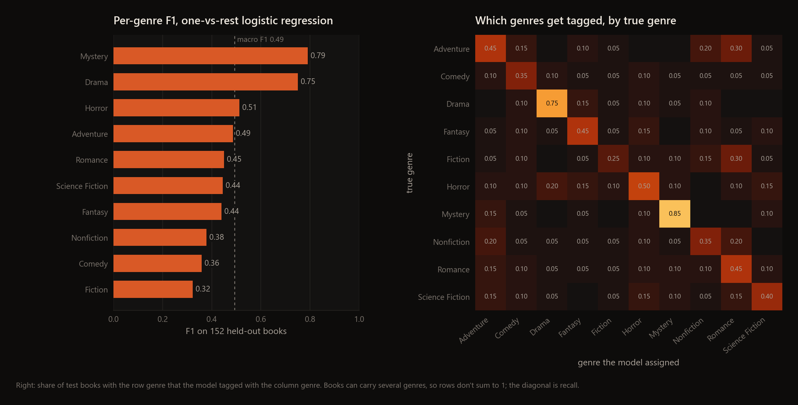
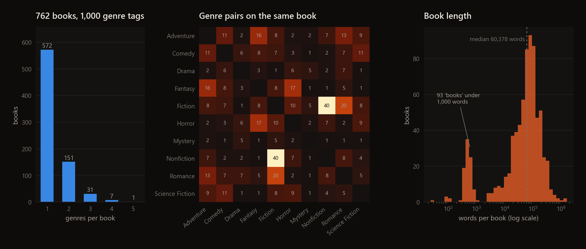
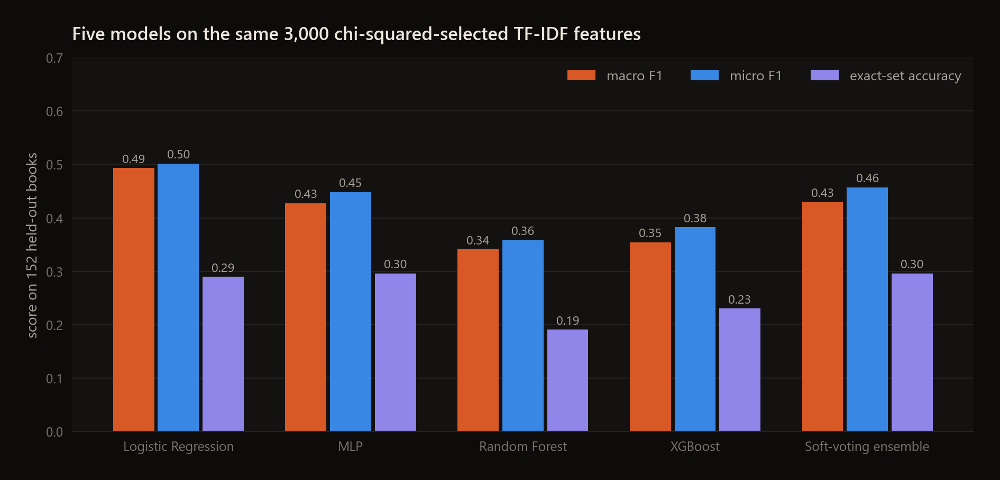

<div align="center">

# Multi-Genre Novel Classification

**Multi-label genre tagging for 762 Project Gutenberg books: TF-IDF, chi-squared feature selection and one-vs-rest classifiers, with LSTM and RoBERTa attempts.**




</div>

A group project with [Omar](https://github.com/alsadio), [Abdullah Al Salmi](https://github.com/abalsalmi)
and [Abdullah Al Rashdi](https://github.com/Al-Rashdi). We pulled English books from Project Gutenberg through the
Gutendex API, turned each book's library subject headings into up to ten genre labels, and tried to predict those
labels from the full text. The best model, a one-vs-rest logistic regression on 3,000 chi-squared-selected TF-IDF
features, reaches macro F1 0.49 on 152 held-out books. Mystery and Drama are easy; Fiction and Comedy stay around 0.3.

## Highlights

- One-vs-rest logistic regression gets macro F1 0.493 and micro F1 0.501 on 152 held-out books when I re-run `BasicModels.ipynb`, matching the notebook's stored output (0.49 and 0.50).
- Mystery (0.79) and Drama (0.75) are the easy genres. The notebook's top TF-IDF words show why: holmes, poirot and watson for Mystery; enter, scene, lord and hath for Drama.
- Logistic regression beats the other three classical models on the same features (MLP 0.43, XGBoost 0.35, random forest 0.34), and a soft-voting ensemble of all four doesn't improve on it (0.43).
- 93 of the 762 "books" are under 1,000 words and contain no book text: most are audiobook index pages, and one is PNG image data. 108 books are copies of 50 titles under different Gutenberg IDs, including four Frankensteins and four Pride and Prejudices.
- The notebook fits TF-IDF and the chi-squared selector on all 762 books before splitting. Fitting both on the training books only gives macro F1 0.512, so that leak didn't inflate the score.

---

## How it works


`Book Collector.ipynb` walks Gutendex page by page, keeps English books, and maps each subject heading to a genre
when `fuzz.partial_ratio` against one of that genre's keywords is at least 85. Each genre stops accepting books at
100, and a book only gets the genres that were still open when it came up, so every genre ends with exactly 100
books and the later books carry fewer labels than their subjects would justify. `BasicModels.ipynb` cleans the text,
fits TF-IDF (5,000 terms) and a chi-squared selector (3,000 terms), splits with `MultilabelStratifiedShuffleSplit`,
and trains one binary classifier per genre.



Three quarters of the books have a single genre. The co-occurrence map shows the fuzzy matching at work: Fiction
and Nonfiction share 40 books, because keywords like "psychology" and "history" match headings such as
"Psychological fiction" and "Historical fiction". The length histogram has a second cluster under 1,000 words; those
documents are not books at all (see Limitations).

## Results

My re-run of `BasicModels.ipynb` through `scripts/make_figures.py`: same preprocessing, features, split and
hyperparameters, 152 test books with 200 genre labels (20 per genre).



| model | macro F1 | micro F1 | exact-set accuracy | Hamming loss |
|---|---|---|---|---|
| Logistic regression (C = 10, balanced) | **0.493** | **0.501** | 0.289 | 0.126 |
| MLP (200 tanh units) | 0.427 | 0.448 | **0.296** | 0.105 |
| Random forest (200 trees, depth 10) | 0.341 | 0.358 | 0.191 | 0.118 |
| XGBoost (100 rounds, depth 6) | 0.354 | 0.383 | 0.230 | 0.113 |
| Soft-voting ensemble of the four | 0.430 | 0.457 | **0.296** | **0.100** |

The heatmap in the header shows where the logistic regression goes wrong. Its diagonal is per-genre recall, from
0.85 for Mystery to 0.25 for Fiction. Romance is the most common wrong tag: Adventure and Fiction share 13 and 20
books with Romance in the labels, and test books of either genre get tagged Romance 30% of the time. 26 of the 152
test books get no genre at all.

The two deep models are in their own notebooks and I didn't re-run them; these numbers are their stored outputs.
`RNN.ipynb` trains a Keras LSTM on the last 200 tokens of each book (`pad_sequences` truncates from the front by
default) and ends at macro F1 0.08 (micro 0.10) on its own unstratified test split. `RoBERTa.ipynb` fine-tunes
`roberta-base` on the first 128 tokens, and its best validation samples-averaged F1 over 20 Optuna trials was 0.459. Both see a few hundred tokens of a book whose median length is
60,378 words, which is a likely reason they trail a bag-of-words model over the full text.

## Quickstart

```bash
git lfs install
git clone https://github.com/EllE961/Automated-Multi-Genre-Classification-of-Novels.git   # pulls the 429 MB JSON via LFS
cd Automated-Multi-Genre-Classification-of-Novels
pip install -r requirements.txt

python scripts/make_figures.py    # re-runs BasicModels, writes docs/assets/ (about 25 min the first time, 18 after)
```

The notebooks run top to bottom from the repo root. `Book Collector.ipynb` rebuilds `collected_books.json` from the
live API, so a new crawl will not give the same 762 books. `RNN.ipynb` needs TensorFlow and `RoBERTa.ipynb` needs
`transformers`, `torch` and `optuna`, which are not in `requirements.txt`.

## Repository map

```text
Book Collector.ipynb      Gutendex crawl, fuzzy subject-to-genre mapping, Gutenberg header/footer stripping
collected_books.json      762 books: id, title, text, genres (429 MB, Git LFS)
stopwords.txt             custom stopword list, merged with NLTK's English list (Git LFS)
BasicModels.ipynb         preprocessing, TF-IDF, chi-squared selection, LR / MLP / RF / XGBoost / voting, CV, word clouds
NaiveBayes.ipynb          1-3-gram TF-IDF plus a length feature into multinomial Naive Bayes
RNN.ipynb                 Keras LSTM on the last 200 tokens
RoBERTa.ipynb             roberta-base fine-tuning with an Optuna search
scripts/make_figures.py   re-runs the BasicModels pipeline and draws the figures in this README
docs/assets/              figures
```

## Limitations

- The labels are noisy. Fuzzy matching tags Moby Dick as Nonfiction and Romance as well as Fiction and Adventure, Little Women as Nonfiction, and The Republic as Fiction. The per-genre cap of 100 then drops genres from later books. Fiction filled its 100 places within the first 134 books collected (Nonfiction within 229), so the remaining 628 books can never carry the Fiction label, which is likely part of why its F1 is only 0.32.
- 93 documents are not book text. 90 open with an audiobook notice (LibriVox chapter lists with timestamps and reader names, or recorded-performance credits), one is PNG image data saved as text, and the other two are another audiobook credit page and a list of Apollo 11 video files. On the 133 test books with at least 1,000 words, macro F1 is 0.52.
- 108 books are copies of 50 titles under different Gutenberg IDs, often with different label sets, and the split doesn't group them. 19 test books have a same-title copy in the training set; on the other 133, macro F1 is 0.46.
- 20 test books per genre means one book moves a genre's recall by 0.05. A single split, no repeated runs.
- `NaiveBayes.ipynb`'s stored run stops during preprocessing, so there is no Naive Bayes result. I didn't re-run its 1-3-gram vectorizer over 70M words.
- The 429 MB corpus lives in Git LFS, so a clone without LFS gets a pointer file instead of the data.

## License

MIT, see [LICENSE](LICENSE). Book texts are from Project Gutenberg.
